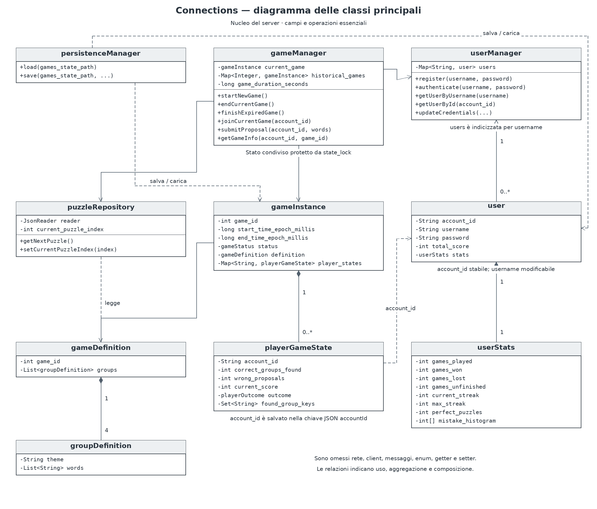

# Connections - Laboratorio III

Filipe Bertolucci · A.A. 2025/2026

Il progetto è una versione client-server di Connections, scritta in Java. Il client si usa da terminale. Le richieste passano su una connessione TCP persistente, mentre le notifiche delle partite arrivano tramite UDP.

La partita è unica per tutti e dura un tempo stabilito nella configurazione del server. Si parte da 16 parole e bisogna trovare tre gruppi corretti di quattro parole. Il quarto gruppo rimane per esclusione. Con quattro errori si perde; dopo una vittoria o una sconfitta bisogna aspettare la partita successiva.

## Requisiti

Servono un JDK 17 o successivo e Gson, già incluso in `lib/gson.jar`. Per i test di integrazione serve anche Python 3.

I comandi sotto sono per Linux o macOS e vanno eseguiti dalla cartella principale del progetto.

## Compilazione

Per compilare:

```bash
rm -rf out/server out/client
mkdir -p out/server out/client dist

javac -cp lib/gson.jar -d out/server $(find src/common src/server -name '*.java')
javac -cp lib/gson.jar -d out/client $(find src/common src/client -name '*.java')

printf 'Manifest-Version: 1.0\nMain-Class: server.serverMain\nClass-Path: ../lib/gson.jar\n\n' > out/server-manifest.mf
printf 'Manifest-Version: 1.0\nMain-Class: client.clientMain\nClass-Path: ../lib/gson.jar\n\n' > out/client-manifest.mf

jar cfm dist/server.jar out/server-manifest.mf -C out/server .
jar cfm dist/client.jar out/client-manifest.mf -C out/client .
```

La cartella `lib` deve rimanere accanto a `dist`, perché i JAR usano la libreria Gson esterna.

## Avvio

Avviare prima il server:

```bash
java -jar dist/server.jar
```

Poi, in un altro terminale, avviare il client:

```bash
java -jar dist/client.jar
```

Il server si può fermare con `Ctrl+C`. Il client si chiude scegliendo `0` dal menu.

## Configurazione

I parametri vengono letti dai file di configurazione, senza passarli dalla riga di comando.

In `config/server-config.properties` si trovano:

- `server.host`: indirizzo su cui il server ascolta, inizialmente `127.0.0.1`;
- `server.tcp.port`: porta TCP, inizialmente `5000`;
- `server.tcp.read.timeout.seconds`: timeout di lettura delle connessioni inattive, inizialmente `1800` secondi;
- `server.threadpool.size`: numero di thread per gestire le connessioni, inizialmente `8`;
- `server.game.duration.seconds`: durata della partita, inizialmente `600` secondi;
- `server.persistence.period.seconds`: intervallo dei salvataggi, inizialmente `30` secondi;
- `server.data.puzzles.path` e `server.data.games.path`: percorsi dei dati.

In `config/client-config.properties` si impostano l'indirizzo del server (`server.host`), la porta TCP (`server.tcp.port`) e la porta UDP del client (`client.udp.port`). I valori iniziali sono `127.0.0.1`, `5000` e `5001`. `client.udp.fragment.timeout.seconds` imposta l'attesa massima dei frammenti (10 secondi); `client.udp.receive.timeout.millis` imposta ogni quanto il ricevitore può controllare i frammenti scaduti anche senza nuovi pacchetti (500 millisecondi).

Per provare più client sullo stesso computer bisogna assegnare una porta UDP diversa a ciascuno, cambiando la configurazione prima di avviare ogni client. Ogni connessione occupa un thread finché rimane aperta. Quando tutti i thread sono occupati, le nuove connessioni vengono chiuse. Le connessioni inattive oltre il timeout vengono disconnesse. In quel caso bisogna riavviare il client e fare login: i progressi rimangono salvati sul server. Ogni richiesta TCP può contenere al massimo 16384 caratteri.

## Uso del client

Nel menu iniziale si può creare un account oppure fare login. Dopo il login si entra automaticamente nella partita corrente. Se si era già partecipato, vengono recuperati i gruppi trovati e gli errori fatti.

Il menu dopo il login permette di:

| Scelta | Operazione |
| --- | --- |
| 1 | Inviare una proposta |
| 2 | Vedere lo stato della partita corrente |
| 3 | Vedere le statistiche della partita corrente |
| 4 | Consultare la classifica completa, i primi K o un singolo giocatore |
| 5 | Vedere le proprie statistiche |
| 6 | Cambiare username o password |
| 7 | Fare logout |
| 8 | Consultare una partita tramite il suo ID |
| 9 | Consultare le statistiche di una partita tramite il suo ID |
| 0 | Uscire |

Per una proposta si possono inserire i numeri delle parole, per esempio `1 3 7 12`, oppure le parole separate da virgole:

```text
RAIN,SNOW,SLEET,HAIL
```

Ogni gruppo corretto vale 6 punti, fino a 18 punti per la vittoria. Ogni proposta sbagliata toglie 4 punti. Una proposta malformata, per esempio con parole duplicate, inesistenti o già risolte, viene rifiutata senza modificare il punteggio.

Alla vittoria o alla sconfitta il client mostra la soluzione completa anche nella risposta TCP. Le notifiche e le richieste delle statistiche dal menu mostrano la classifica della partita.

Il client aggiunge alle proposte l’ID della scheda visualizzata: se nel frattempo cambia partita, la proposta viene rifiutata senza modificare il punteggio.

Cambiare username o fare logout non permette di ricominciare la stessa partita. Sono ammesse più connessioni dello stesso account, che condividono la partecipazione. Alla partita successiva entrano automaticamente soltanto gli utenti ancora autenticati.

Le notifiche UDP mostrano gli aggiornamenti delle partite. UDP non garantisce la consegna: se manca una notifica, dal menu si possono richiedere nuovamente stato e statistiche. Non c'è un controllo TCP periodico: il recupero si fa dal menu. I duplicati UDP recenti vengono ignorati. Il client accetta fino a 8 notifiche incomplete, ciascuna con al massimo 1024 frammenti da 750 byte; oltre questi limiti segnala di consultare stato e statistiche via TCP. Le richieste TCP usano `gameId: -1` per indicare la partita corrente; le statistiche della partita includono anche la sua classifica.

## Dati salvati

`data/puzzles.json` contiene i puzzle. Il server li legge uno alla volta; quando arriva alla fine ricomincia dall'inizio, assegnando comunque nuovi ID alle partite.

Con la configurazione fornita, il salvataggio completo è in `data/games_state.json.snapshot.json`. Contiene utenti, punteggi, partita corrente, storico e posizione nel dataset. Viene aggiornato periodicamente e durante l'arresto regolare del server. Al riavvio viene mantenuta la scadenza della partita salvata.

Se lo snapshot non esiste, il server parte senza utenti e senza storico. Se il file è incompleto o contiene JSON non valido, l'avvio viene interrotto senza sovrascriverlo. Le partecipazioni sono associate agli utenti tramite `accountId`; `username` indica il nome usato per il login.

## Test

Dopo la compilazione si possono eseguire i test delle regole e della persistenza:

```bash
mkdir -p out/tests
javac -cp lib/gson.jar:out/server -d out/tests tests/coreTestMain.java tests/robustnessTestMain.java
java -cp lib/gson.jar:out/server:out/tests coreTestMain
java -cp lib/gson.jar:out/server:out/tests robustnessTestMain
```

Per verificare riordino, duplicati, frammenti mancanti e scadenze UDP senza aprire socket:

```bash
javac -cp lib/gson.jar:out/client -d out/tests tests/udpFragmentTestMain.java
java -cp lib/gson.jar:out/client:out/tests client.net.udpFragmentTestMain
```

Per verificare la connessione NIO del client, compresa la chiusura durante una lettura in attesa:

```bash
javac -cp out/client -d out/tests tests/clientConnectionTestMain.java
java -cp out/client:out/tests clientConnectionTestMain
```

Per verificare la stampa della soluzione nelle notifiche e delle classifiche nel menu:

```bash
javac -cp lib/gson.jar:out/client -d out/tests tests/clientDisplayTestMain.java
java -cp lib/gson.jar:out/client:out/tests clientDisplayTestMain
```

Per le prove con server e client reali:

```bash
python3 tests/integration.py
```

Il test di integrazione usa i JAR in `dist`, porte locali e una cartella temporanea. Controlla login, proposte, sessioni multiple, notifiche, richieste concorrenti, rotazione, riavvio e riutilizzo dei puzzle. I dati della cartella `data` del progetto non vengono modificati dal test.

## Diagramma delle classi



Il diagramma mostra il nucleo del server. Sono omessi client, rete e messaggi. Il sorgente è in [class-diagram.mermaid](class-diagram.mermaid).

## Cartelle principali

- `src/common`: modelli, messaggi JSON e utilità condivise;
- `src/server`: gestione utenti, partite, connessioni e salvataggi;
- `src/client`: menu e comunicazione con il server;
- `config`: configurazioni di client e server;
- `data`: dataset e dati persistenti;
- `lib`: libreria Gson;
- `tests`: programmi di verifica;
- `out` e `dist`: classi compilate e JAR.
